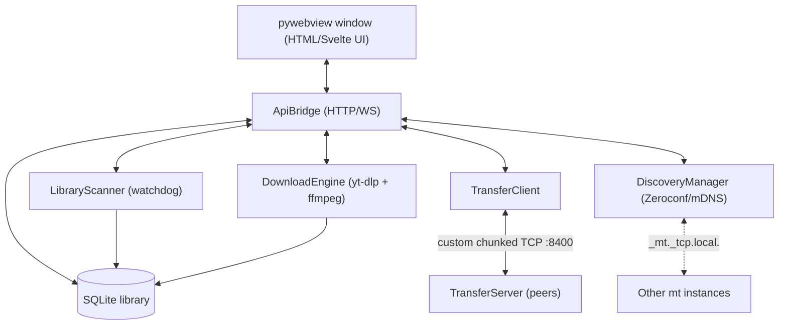

# mt — YouTube Downloader & LAN P2P Media Sharer

> Download media locally, catalog it, and share it peer-to-peer across your local network — no cloud, no accounts.


`mt` is a cross-platform desktop application (native window via `pywebview`) that does four things:

1. **Download** high-quality YouTube video/audio locally with `yt-dlp` + `ffmpeg`.
2. **Catalog** the downloaded files in a local SQLite database.
3. **Discover** other `mt` instances on the same Wi-Fi/LAN automatically via Zeroconf/mDNS.
4. **Share & stream** media peer-to-peer over a custom chunked TCP protocol with resume support.

## Architecture

A single native window hosts the UI; everything else runs on a background `asyncio` loop in a worker thread. Subsystems talk to the UI through an event bus (`ApiBridge.broadcast_event`).



## Wire protocol

A compact, framed TCP protocol (magic `0x4D 0x54` = `"MT"`, version `1`):

| Code | Message | Purpose |
|------|---------|---------|
| `0x01` / `0x02` | `CATALOG_REQ` / `CATALOG_RES` | Ask a peer what it has |
| `0x10` | `TRANSFER_REQ` | Request a file |
| `0x11` | `TRANSFER_META` | File metadata (name, size, hash) |
| `0x12` / `0x13` | `CHUNK_HEADER` / `CHUNK_DATA` | 1 MiB data chunks |
| `0x14` | `CHUNK_ACK` | Per-chunk acknowledgement (enables resume) |
| `0x15` | `TRANSFER_COMPLETE` | Transfer finished |
| `0x20` | `TRANSFER_CANCEL` | Abort a transfer |
| `0x30` / `0x31` | `PING` / `PONG` | Keepalive (every 10 s; 30 s timeout) |
| `0xFF` | `ERROR` | Protocol error |

Discovery service type: `_mt._tcp.local.` · Default transfer port: `8400` · Chunk size: `1 MiB`.

## Project structure

```
mt/
├── pyproject.toml              # Hatchling build; deps (yt-dlp, pywebview, zeroconf, …)
├── README.md
└── src/
    └── mt/
        ├── app.py              # Application shell: asyncio thread + pywebview window
        ├── config.py           # Paths, ports
        ├── constants.py        # Wire-protocol constants
        ├── api/bridge.py       # UI bridge: HTTP endpoints + event broadcast
        ├── core/
        │   ├── download_engine.py   # yt-dlp/ffmpeg orchestration
        │   ├── library_scanner.py   # Filesystem watcher → catalog
        │   └── media_info.py        # Metadata extraction
        ├── db/database.py      # SQLite (aiosqlite) catalog
        ├── network/
        │   ├── discovery.py         # Zeroconf/mDNS peer discovery
        │   ├── protocol.py          # Framing + message encode/decode
        │   ├── manifest.py          # Shared-library manifests
        │   ├── transfer_server.py   # Serve chunks to peers
        │   └── transfer_client.py   # Request + receive chunks (resumable)
        └── utils/
            ├── hashing.py           # Streaming file hashing
            └── network.py           # Local IP helpers
```

## Requirements

- **Python 3.12+**
- **FFmpeg** on your `PATH` (or placed in the app root)
- Optional: **Node.js 18+** to build the Svelte frontend

## Setup

```bash
# 1. Install the Python package (editable)
pip install -e .

# 2. Build the frontend (if you have the frontend sources)
cd frontend
npm install
npm run build
cd ..

# 3. Run
python -m mt
```

> **Note:** this repository contains the **Python backend/engine**. `app.py` loads the UI from `frontend/dist/index.html`; if that build is absent it shows a placeholder. Drop your built frontend into `frontend/dist/` to use the full UI.

## License

[MIT](LICENSE) © 2026 Omar Hindawy
